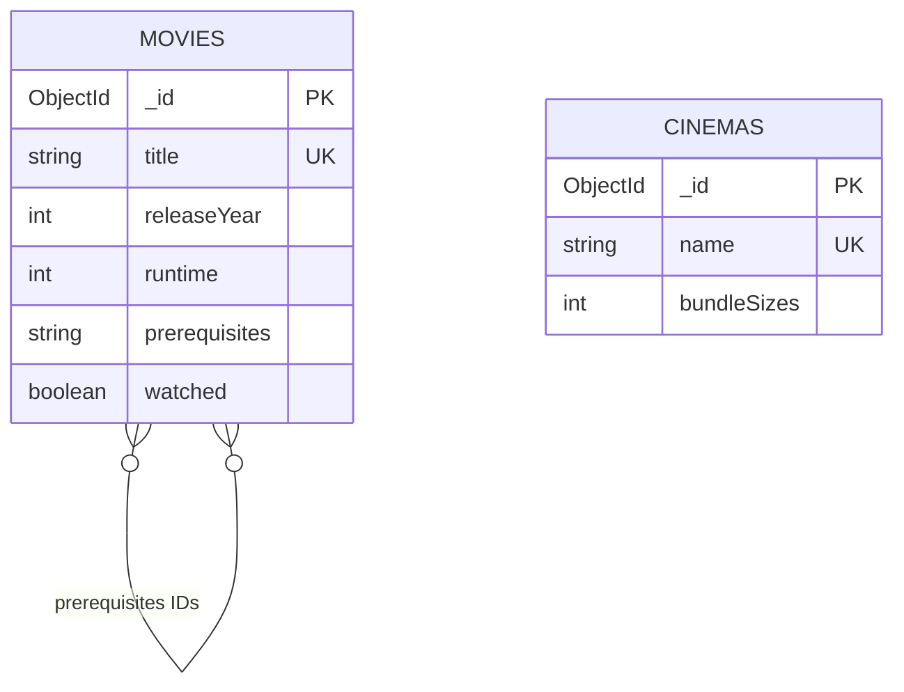

# Doomsday Ready

Doomsday Ready is a full-stack assessment application for managing Marvel movie prerequisites, viewing backend-generated rewatch plans, and requesting minimum-bundle cinema booking quotes.

The frontend and backend are maintained in separate folders. The backend owns movie dependency validation, rewatch ordering, and booking calculations; the React app displays the API responses.

## Technologies

| Area | Technologies |
| --- | --- |
| Frontend | React, JavaScript, Vite, Tailwind CSS v4 |
| Backend | Node.js, Express, JavaScript |
| Database | MongoDB with the official Node.js driver |
| API requests | Browser `fetch()` API |

## Features

- Browse movies and create movies with prerequisite movie IDs.
- Edit prerequisite relationships and toggle watched status.
- View backend-generated prerequisite order, watched progress, and remaining runtime.
- Select a cinema and request a booking quote for a group size.
- See minimum bundle counts, bundle breakdowns, and impossible combinations.
- Use shared success, error, warning, and information notifications.

## Project Structure

The two repositories should be checked out next to each other:

```text
workspace/
├── doomsday-ready-client/       # This repository
└── doomsday-ready-server/       # Backend repository
```

### Frontend

```text
src/
├── api.js
├── App.jsx
├── index.css
├── main.jsx
├── components/
│   ├── BookingForm.jsx
│   ├── BookingResult.jsx
│   ├── CinemaSelector.jsx
│   ├── Header.jsx
│   ├── MovieSelector.jsx
│   ├── Navigation.jsx
│   ├── RewatchOrderList.jsx
│   ├── RewatchProgress.jsx
│   └── ToastProvider.jsx
├── pages/
│   ├── Booking.jsx
│   ├── Movies.jsx
│   └── RewatchPlan.jsx
└── toast/
    ├── ToastContext.js
    └── useToast.js
```

### Backend

```text
doomsday-ready-server/
├── Config/          # MongoDB connection and indexes
├── Controller/      # Express request handlers
├── Repository/      # MongoDB collection operations
├── Routes/          # API routes
├── Service/         # Validation and application operations
├── Utils/           # Rewatch and booking algorithms
├── Validation/      # Request field validation
├── app.js
└── index.js
```

## Requirements

- Node.js **20.19+** or **22.12+** (Vite 8 requirement; MongoDB driver requires Node.js 20.19+).
- npm.
- A running local MongoDB instance or an accessible MongoDB deployment.

For platform-specific local installation or an Atlas setup, follow the [official MongoDB getting-started documentation](https://www.mongodb.com/docs/get-started/).

## Setup and Run

### 1. Get both folders

Place the frontend and backend folders next to each other as shown in [Project Structure](#project-structure). This README is in `doomsday-ready-client`; commands below assume the backend folder is at `../doomsday-ready-server`.

### 2. Configure and start MongoDB and the backend

Start your local MongoDB service, or prepare a MongoDB connection string. From the workspace directory that contains both repositories, open a terminal and run:

```bash
cd doomsday-ready-server
npm install
cp .env.example .env
```

The backend `.env.example` contains these variables:

| Variable | Purpose |
| --- | --- |
| `PORT` | API port; defaults to `5000` in the server if omitted. |
| `NODE_ENV` | Environment label included in the example configuration. |
| `MONGODB_URI` | MongoDB connection string. The example uses `mongodb://127.0.0.1:27017`. |
| `DB_NAME` | MongoDB database name; the example uses `doomsday_ready`. |

Edit the local `.env` if your MongoDB connection or database name differs. **Do not commit `.env` or put credentials in this README.**

Start the backend:

```bash
npm run dev
```

The development script runs `node --watch index.js`. The server connects to MongoDB, creates the unique movie-title and cinema-name indexes, and listens on port `5000` by default. The API root at `http://localhost:5000/` returns a short server status message.

### 3. Configure and start the frontend

Open a second terminal in the workspace directory and run:

```bash
cd doomsday-ready-client
npm install
cp .env.example .env
```

The frontend environment variable is:

| Variable | Purpose |
| --- | --- |
| `VITE_API_BASE_URL` | Backend base URL. The example value is `http://localhost:5000`. |

Start Vite:

```bash
npm run dev
```

Open the local URL printed by Vite (normally `http://localhost:5173`). Keep both development servers running.

### Available scripts

Frontend, from `doomsday-ready-client`:

```bash
npm run dev       # Start the Vite development server
npm run build     # Build the production frontend
npm run lint      # Run Oxlint
npm run preview   # Preview a production build
```

Backend, from `doomsday-ready-server`:

```bash
npm run dev       # Start Node with --watch
npm start         # Start the backend
npm test          # Run Node's built-in test runner
```

The backend currently has no automated test files, so `npm test` reports zero tests.

## MongoDB Data Model

The backend uses two collections: `movies` and `cinemas`. MongoDB creates the collections when documents are first inserted. The backend creates unique, case-insensitive indexes for movie titles and cinema names.



`movies.prerequisites` is an array of strings; each entry is the string form of another movie's MongoDB `_id`. `cinemas.bundleSizes` is an array of integers. Prerequisite movie documents are not embedded. The service checks that referenced movies exist, rejects duplicate/self references, and rejects circular dependencies. `watched` defaults to `false`; `prerequisites` defaults to an empty array when omitted from a create request.

## Sample Data

Sample records are **not inserted automatically**; there is no seed script. Add movies and cinemas through the frontend or the API. When creating movies with prerequisites, create prerequisite movies first and use the `_id` returned by the API.

### Assessment movies

| Movie | Year | Runtime | Direct prerequisites |
| --- | ---: | ---: | --- |
| Iron Man | 2008 | 126 min | None |
| Captain America: The First Avenger | 2011 | 124 min | None |
| The Avengers | 2012 | 143 min | Iron Man; Captain America: The First Avenger |
| Captain America: Civil War | 2016 | 147 min | The Avengers |
| Thor: Ragnarok | 2017 | 130 min | None |
| Avengers: Infinity War | 2018 | 149 min | Captain America: Civil War; Thor: Ragnarok |
| Avengers: Endgame | 2019 | 181 min | Avengers: Infinity War |
| Avengers: Doomsday | 2026 | 150 min | Avengers: Endgame |

The 150-minute runtime for **Avengers: Doomsday** is demo data from the assessment. New movies default to unwatched.

### Assessment cinemas

| Cinema | Bundle sizes (seats) |
| --- | --- |
| Avengers Infinity Cinema | 1, 3, 4 |
| Stark Multiplex | 2, 5 |
| Asgard Movie Hall | 6, 9, 20 |
| Wakanda Cinema | 4, 6 |

## API Reference

Base URL for local development: `http://localhost:5000`. Successful responses use a JSON envelope with `success: true` and a `data` field. Error responses include `success: false` and a human-readable `message`; movie write errors may also include a `code`.

| Method and path | Request | Successful response |
| --- | --- | --- |
| `POST /api/movies` | JSON movie fields: `title`, `releaseYear`, `runtime`; optional `prerequisites` (movie ID strings) and `watched`. | `201`, `{ success, message, data: movie }` |
| `GET /api/movies` | None. | `200`, `{ success, data: movie[] }` |
| `PATCH /api/movies/:id` | JSON with one or more supported movie fields. | `200`, `{ success, message, data: movie }` |
| `GET /api/movies/:id/rewatch-order` | None. | `200`, `{ success, data: { rewatchOrder, watchedCount, totalMovies, remainingRuntime } }` |
| `POST /api/cinemas` | JSON `{ name, bundleSizes }`. | `201`, `{ success, data: cinema }` |
| `GET /api/cinemas` | None. | `200`, `{ success, data: cinema[] }` |
| `GET /api/cinemas/:id/booking?groupSize=6` | A cinema ID and integer group size from 1 to 10,000. | `200`, `{ success, data: bookingQuote }` |

The rewatch endpoint returns the prerequisite movies in backend order and excludes the selected target movie. The booking endpoint returns either `{ possible: true, cinema, groupSize, totalBundles, bundles }` or `{ possible: false, message }`. The backend computes order and bundle combinations; the frontend does not repeat those algorithms.

Validation notes:

- Movie titles must be non-empty; release year must be a positive integer; runtime must be an integer from 1 to 300 minutes.
- Cinema names must be non-empty. A cinema must have 1–10 unique bundle sizes, each an integer from 1 to 500.
- Duplicate movie titles and cinema names are rejected with `409` responses.
- A circular movie prerequisite update returns `409` with code `CIRCULAR_DEPENDENCY`.
- Invalid input commonly returns `400`; a missing rewatch target or cinema returns `404`.

## Example API Requests

Set a local API base URL in a terminal:

```bash
API_BASE_URL=http://localhost:5000
```

Create a movie with no prerequisites:

```bash
curl -X POST "$API_BASE_URL/api/movies" \
  -H 'Content-Type: application/json' \
  -d '{
    "title": "Iron Man",
    "releaseYear": 2008,
    "runtime": 126,
    "prerequisites": [],
    "watched": false
  }'
```

The response includes the created movie's `_id`. Use that ID when setting another movie's prerequisites. For example, mark a movie watched:

```bash
curl -X PATCH "$API_BASE_URL/api/movies/MOVIE_ID" \
  -H 'Content-Type: application/json' \
  -d '{"watched": true}'
```

Fetch a rewatch plan:

```bash
curl "$API_BASE_URL/api/movies/MOVIE_ID/rewatch-order"
```

Create a cinema and request a booking quote:

```bash
curl -X POST "$API_BASE_URL/api/cinemas" \
  -H 'Content-Type: application/json' \
  -d '{"name":"Avengers Infinity Cinema","bundleSizes":[1,3,4]}'

curl "$API_BASE_URL/api/cinemas/CINEMA_ID/booking?groupSize=6"
```

An example possible booking response is:

```json
{
  "success": true,
  "data": {
    "possible": true,
    "cinema": "Avengers Infinity Cinema",
    "groupSize": 6,
    "totalBundles": 2,
    "bundles": { "3": 2 }
  }
}
```

## AI Usage Disclosure

AI assistance was used during this project for frontend implementation and UI refinement, API integration, debugging, code review, and documentation drafting. The documented endpoints and data fields were checked against the backend source. Frontend build and lint commands have been run; the backend's configured test command currently finds no automated test cases. The project maintainer should review changes and run the application in their own environment before release.
